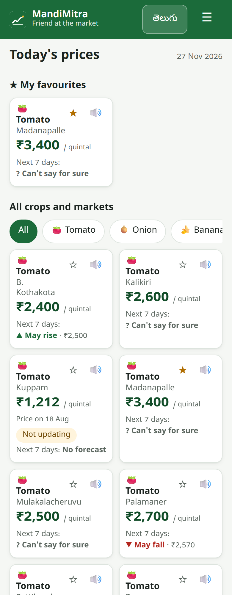
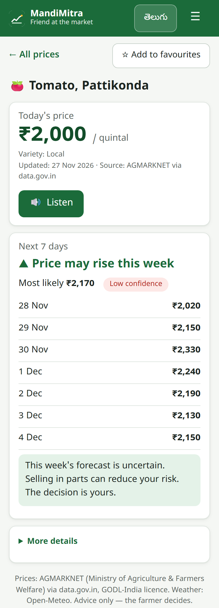
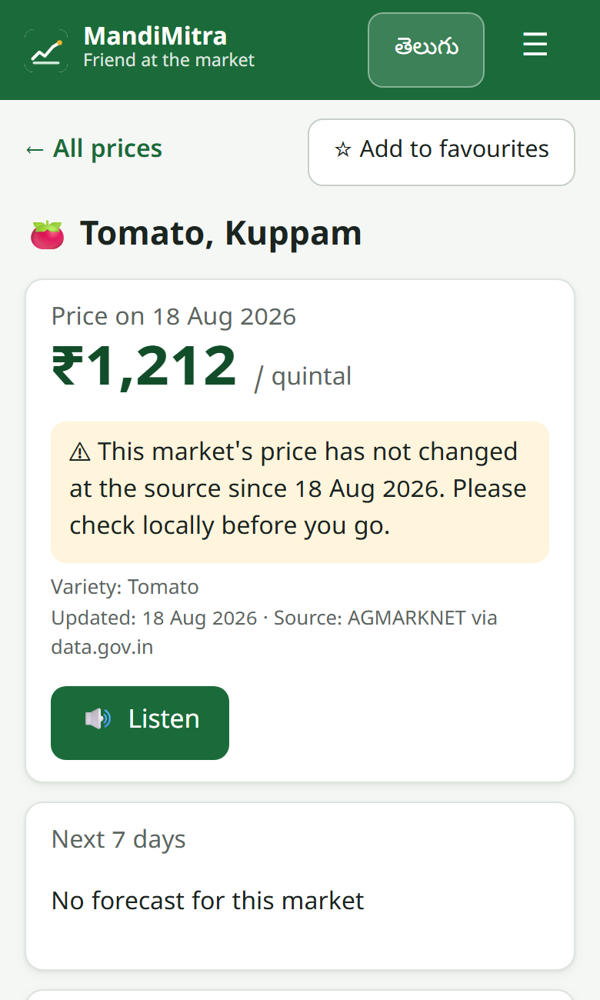
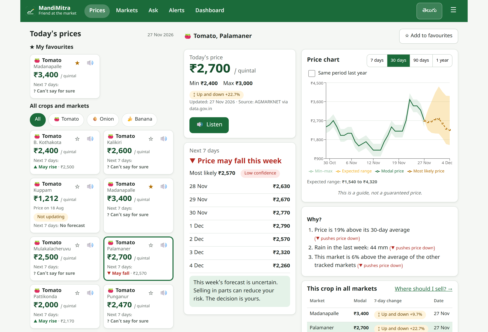
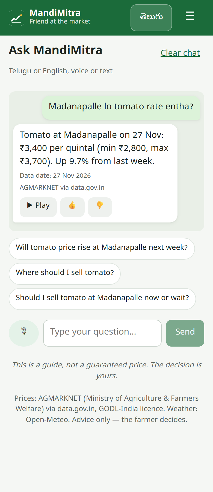
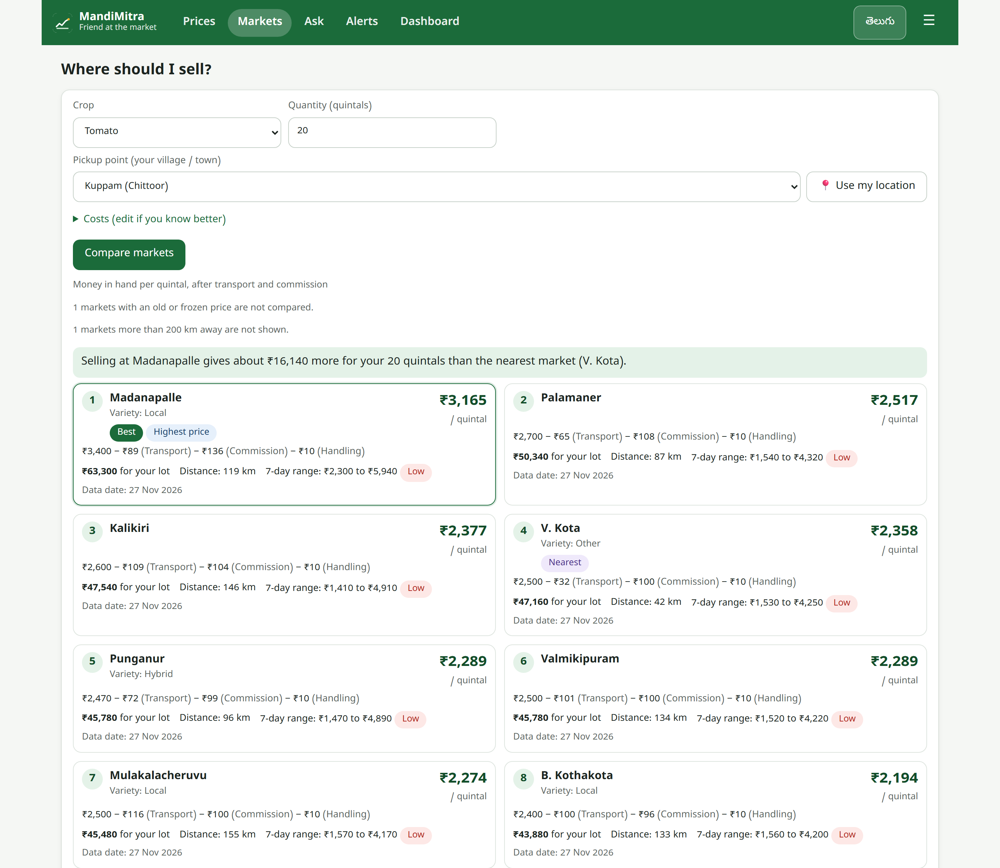
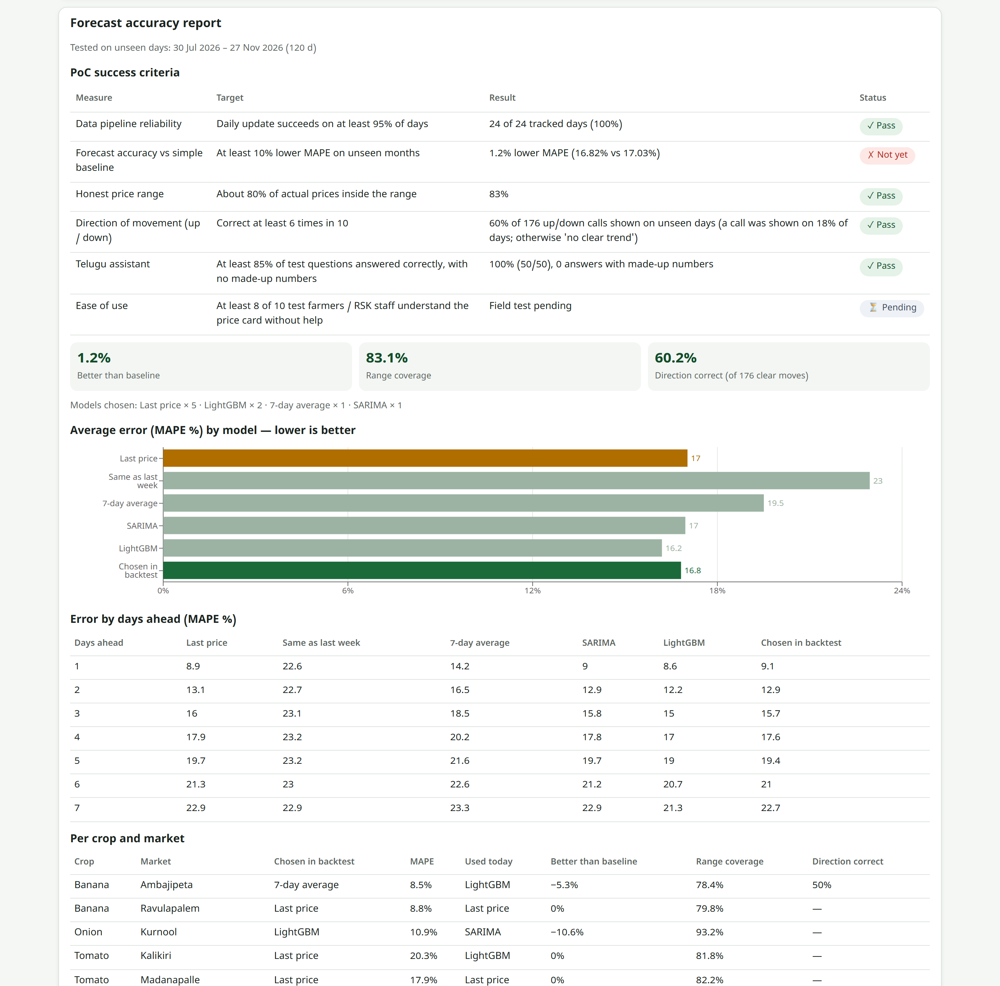
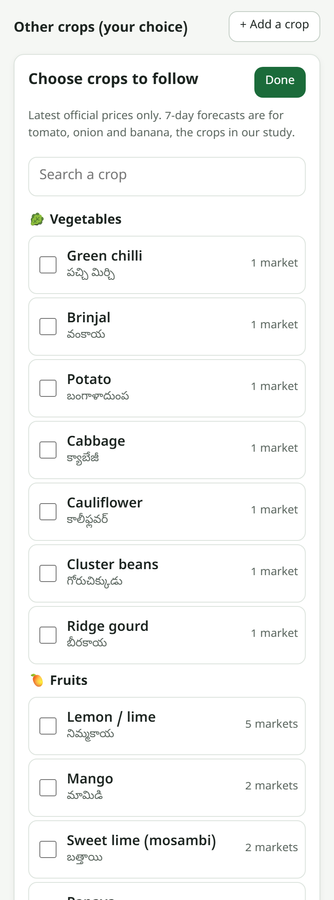
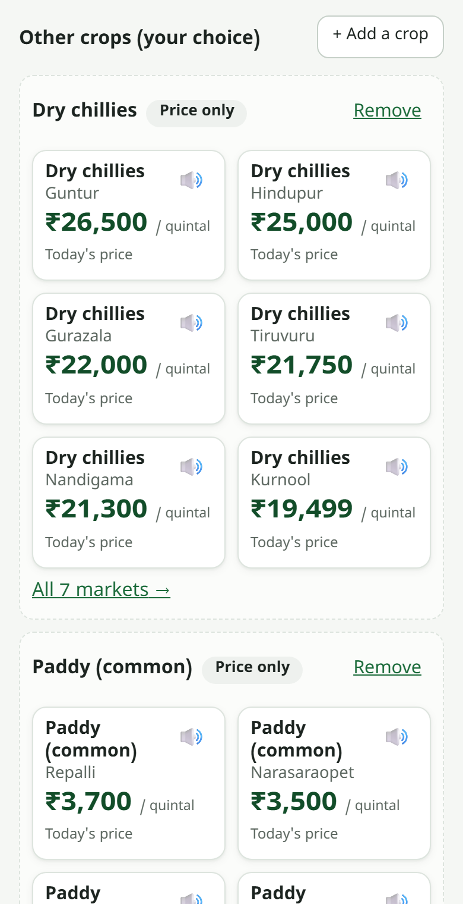

# MandiMitra — Project report

**AI-powered market intelligence for horticulture farmers in Andhra Pradesh**

- **Programme:** TechBharat AI CoE, Cohort #2 · Problem statement C2-17
- **Team:** Deepak Jaggupalli, Alasapuri Likhith Srikar
- **Version:** 1.0 · 27 November 2026
- **Live app:** https://mandimitra-alpha.vercel.app
- **Code:** https://github.com/DeepakJaggupalli/MandiMitra

*Data in this report: real AGMARKNET prices up to 27 November 2026, as served by the live app. A Word version is in [MandiMitra_Project_Report.docx](MandiMitra_Project_Report.docx) and the slides in [MandiMitra_Presentation.pptx](MandiMitra_Presentation.pptx).*

## 1. Summary

MandiMitra ("friend at the market") helps a horticulture farmer in Andhra Pradesh answer two everyday questions: **what is the price today**, and **is it likely to go up or down this week**. It reads the official daily mandi prices (AGMARKNET) for **tomato, onion and banana** at **17 Andhra Pradesh markets**, cleans them, looks 7 days ahead, finds the best nearby market after transport and commission, and explains the answer in simple **Telugu or English**, by text or voice. It only advises; the farmer decides.

The system is **working and live** at https://mandimitra-alpha.vercel.app. It updates itself twice a day from the Government of India's open data platform (data.gov.in). All the code, data handling and this report are in the GitHub repository https://github.com/DeepakJaggupalli/MandiMitra.

Results on real data (test period 30 July 2026 to 27 November 2026, days the models had not seen):

| Measure | Target | Result |
| --- | --- | --- |
| Actual prices inside the shown 80% range | About 80% | 83% (met) |
| Rise / fall arrows correct | At least 6 in 10 | 60% of 176 arrows shown (met; an arrow is shown on 18% of days) |
| Average error compared with "last price" | At least 10% lower | 1.2% lower (not met). LightGBM alone is 4.9% lower |
| Telugu / English assistant | 85% of test questions right, no made-up numbers | 50 of 50 on our question set; 37 of 40 on an independent reviewer's fresh questions |
| Daily update reliability | At least 95% of days | 24 of 24 tracked days |
| Ease of use | 8 of 10 farmers understand the price card | Field test still to be done |

The main lesson: real tomato prices move a lot within a week, so even the best model is only a little better than assuming "tomorrow's price = today's price". MandiMitra is built to be honest about this. It shows a rise or fall arrow only at markets where its past calls were right at least 6 times in 10, and otherwise says **"can't say for sure"** and shows the likely price range.

Next steps: add arrival quantities (the strongest missing signal), run the field test with farmers and Rythu Seva Kendra (RSK) staff, connect a permanent database for officer approvals, and re-measure accuracy on the coming weeks with the selection rule now frozen.

## 2. The problem

Horticulture produce such as tomato, onion and banana is perishable, and its price can rise or fall sharply within days. A farmer deciding when and where to sell usually depends on a phone call to a trader or a neighbour. Public price data exists, but it is spread across several websites, uses different names and units, shows only past prices, and is not written for farmers.

So a farmer cannot easily answer simple questions:

- What is the price today in nearby markets?
- Is it going up or down?
- Is the market flooded with arrivals?
- Which market gives me more money after transport?
- Should I sell today or wait a few days?

Why it matters: perishable crops cannot wait, so selling in the wrong market or on the wrong day directly reduces farm income. The same crop sells at different prices in different markets on the same day, but farmers rarely see this side by side. A 2026 ANGRAU study in Andhra Pradesh found that farmers who followed market-intelligence advisories obtained a measurable price premium.

## 3. Who it is for

| User | How they use MandiMitra |
| --- | --- |
| Horticulture farmers (primary) | Today's price and the next 7 days on simple tiles, voice playback in Telugu, favourite markets, price alerts, "where should I sell" for their quantity and village. |
| Farmer Producer Organisations (FPOs) | Multi-market view, collective-sale planner for a large lot, share prices with members. |
| Extension workers and RSK staff | Answer farmers with evidence, approve big-move warnings, edit and approve the weekly Telugu bulletin. |
| Traders and aggregators | Price levels and trends across markets. |
| ANGRAU AMIC, Horticulture and Marketing Departments | Forecast accuracy report, data-quality report, audit log of every agent action. |

## 4. What we set out to do

These are the objectives from our Solution Design Document (13 October 2026) and where each one stands now.

| Objective | How we show it | Status |
| --- | --- | --- |
| Bring daily prices for the selected crops and markets into one clean place | Automatic update twice a day; date and source on every screen | Done (real AGMARKNET data) |
| Predict a short-term price range, not a single "guaranteed" price | Most likely price, range and confidence; backtest against simple methods | Done; range is honest (83% coverage); accuracy gain smaller than hoped |
| Compare markets on the money the farmer takes home | Markets ranked by net price after transport, commission and handling | Done (within 200 km, editable costs) |
| Explain every result in simple words | Top reasons for each forecast | Done (shown only when the explaining model made the forecast) |
| Easy to use in Telugu, by voice or text, on a basic phone | Telugu-first app, voice questions, spoken answers, works offline | Done; field test pending |
| Warn users about big price moves | Target-price alerts; unusual moves reviewed by an officer | Done |

## 5. From design to a working product

| When | Step | What changed and why |
| --- | --- | --- |
| 13 Oct 2026 | Solution Design Document v1.0 | Agreed scope: tomato, onion, banana in 6 to 8 Andhra Pradesh markets; Telugu-first app; four agents; honest ranges. |
| 4 Nov 2026 | First complete build | Data pipeline, models, FastAPI backend, Telugu app, assistant, dashboard, admin, tests and automatic deployment. It ran on a clearly labelled sample dataset in AGMARKNET format while real data access was arranged. |
| 9 Nov 2026 | Leadership check-in | Progress deck shared with TechBharat. |
| 27 Nov 2026 | Mentor feedback | The phone screen was too crowded. We rebuilt the farmer view as small tiles (crop, market, today's price, next 7 days up or down), with audio and favourites, and moved the details behind a tap. |
| 27 Nov 2026 | Real data | With a data.gov.in API key we pulled every Andhra Pradesh record for the three crops since 2022 and chose the markets from what actually reports. We found that data.gov.in refuses servers outside India, so the daily update now goes through a small locked relay in Mumbai. |
| 27 Nov 2026 | Independent audit | Four separate reviewers checked data, testing, the assistant and the wording. Every real issue was fixed (Section 12). |
| 27 Nov 2026 | Desktop view and other crops | Desktop got a full layout back (phones keep the simple view). Farmers can now add any of 45 other crops to follow, prices only. |

## 6. Data

### 6.1 Sources

| Data | Source | Use |
| --- | --- | --- |
| Daily minimum, maximum and modal price per market, variety and grade | AGMARKNET (Directorate of Marketing & Inspection, Ministry of Agriculture & Farmers Welfare) through the official data.gov.in API; GODL-India licence | Everything: prices, trends, forecasts, comparisons |
| Rainfall and temperature per market | Open-Meteo (free, no key) | Weather signal in the model |
| Market and town locations | OpenStreetMap (Nominatim) | Distances for the best-market finder; map |
| Crop calendar (harvest and lean months) | First estimates, to be validated with ANGRAU / Horticulture Department | Season signal and explanations |
| Transport, commission and handling costs | First estimates; farmers can edit them; to be replaced by an FPO cost survey | Net price calculation |

The data.gov.in resources do not include arrival quantities (how much produce came to the market). Arrivals can be added from AGMARKNET exports or our teammate's scraper; the app is ready for them.

### 6.2 Choosing the markets

The design document named example markets (Madanapalle, Pattikonda, Kurnool, Anantapur, Kadapa, Vijayawada) and said the final list would be confirmed on data quality. When we pulled the real records, Anantapur, Kadapa town, Vijayawada and Pulivendula had no reports for these crops in this source, while many tomato yards around Madanapalle reported almost every day. So the markets were chosen from what actually reports:

| Crop | Market | District | Reports since | Forecast |
| --- | --- | --- | --- | --- |
| Banana | Ambajipeta | Dr. B.R. Ambedkar Konaseema | 1 January 2022 | Own backtested model |
| Banana | Ravulapalem | Dr. B.R. Ambedkar Konaseema | 1 January 2022 | Own backtested model |
| Banana | Railway Koduru | Tirupati | 24 July 2026 | Crop model, low confidence |
| Banana | Siddavatam | YSR Kadapa | 24 July 2026 | Crop model, low confidence |
| Banana | Tiruchanur (Tirupati) | Tirupati | 23 July 2026 | Price only |
| Onion | Kurnool | Kurnool | 3 January 2022 | Own backtested model |
| Onion | Yerraguntla | YSR Kadapa | 23 July 2026 | Price only |
| Tomato | B. Kothakota | Annamayya | 1 June 2026 | Crop model, low confidence |
| Tomato | Kalikiri | Annamayya | 21 January 2022 | Own backtested model |
| Tomato | Kuppam | Chittoor | 27 July 2026 | Price frozen at source since 18 August 2026 |
| Tomato | Madanapalle | Annamayya | 1 June 2022 | Own backtested model |
| Tomato | Mulakalacheruvu | Annamayya | 1 January 2022 | Own backtested model |
| Tomato | Palamaner | Chittoor | 1 January 2022 | Own backtested model |
| Tomato | Pattikonda | Kurnool | 5 January 2022 | Crop model, low confidence |
| Tomato | Punganur | Annamayya | 1 January 2022 | Own backtested model |
| Tomato | Valmikipuram | Annamayya | 1 January 2022 | Own backtested model |
| Tomato | V. Kota | Chittoor | 30 May 2026 | Crop model, low confidence |

Two markets were renamed inside AGMARKNET and are joined into one series after checking that the price level stays consistent across the change: Vayalapadu became Valmikipuram APMC (tomato), and Ravulapelem became Ravulapalem (Kothapeta APMC) (banana). Old "Tirupati" banana records (around ₹9,000, a different unit from its successor Tiruchanur at around ₹1,600) are kept out. "Gurramkonda sub-yard" publishes the same numbers as Valmikipuram, so it is treated as one market.

### 6.3 How the data is cleaned

- Market and crop names are matched using the exact AGMARKNET names (with or without "APMC"). Farmer spellings are used only by the assistant.
- Prices typed per kilogram are converted to per quintal; duplicate submissions are removed (the API repeats some records).
- One consistent price per market and day: if a market reports a main variety on most days (for example Madanapalle "Local" plus a cheaper "Other" lot on some days), that variety is followed; if several varieties are reported every day (Ravulapalem: 6 banana varieties), their daily median is used; if a market reports one price a day under changing labels (Kalikiri: "Local" in 2024, "Hybrid" in 2025), that daily price is followed. Today's price for every variety is still shown to the farmer.
- A price that repeats unchanged for 15 or more reports in a row is treated as a feed that stopped updating. Kuppam has shown ₹1,212 for every report since 18 August 2026, so the app marks it "price not changing at the source" with no forecast, and leaves it out of comparisons.
- Impossible values (maximum below minimum, modal outside the range, a price more than 2.2 times away from the usual level of the same variety) are flagged and held back until an admin accepts them.
- Missing days are reported, never filled in. Weekly closing days are read from the data.

### 6.4 Data quality today

Raw records: 20,433. Clean daily prices used: 11,844. Duplicates removed: 243. Repeated (frozen) reports left out: 379. Records held for admin review: 26.

| Check | Result | Detail |
| --- | --- | --- |
| All crop-market pairs have data | Pass | 17 of 17 pairs |
| Data is fresh | Needs attention | 1 series older than 3 days |
| Missing days below 15% | Needs attention | worst 82.8% |
| At least 3 years of history | Needs attention | shortest 22 days |
| Flagged records reviewed | Needs attention | 26 waiting for admin review |
| No market price frozen at the source | Needs attention | tomato/kuppam: same price for 67 reports since 2026-08-18 |

5 checks need attention. Each is a real limit of the source, not a fault in the pipeline: Kuppam's feed is frozen, so its last real price is from 18 August 2026; Yerraguntla (onion) has reported on only 22 days so far; older years have gaps at several markets; and 26 unusual records are waiting for an admin to accept or exclude them.

### 6.5 Daily refresh and the Mumbai relay

A GitHub Actions job runs the whole pipeline at 09:30 and 18:00 IST. Each run re-reads the last 10 days (late uploads and corrections land) plus today's file, rebuilds the forecasts and commits the new data; Vercel then redeploys the site. data.gov.in refuses connections from servers outside India, so the job fetches through a small relay that runs in Vercel's Mumbai region. The relay only works with a secret token and only passes on the two AGMARKNET price resources for Andhra Pradesh, so it cannot be used as an open proxy. One request per day returns every crop at once, so following extra crops adds no load.

## 7. How the forecasts work

### 7.1 Models compared

| Model | What it does |
| --- | --- |
| Last price | Assumes the price stays where it is today. A strong baseline for fast-moving crops. |
| Same as last week | Uses the price from 7 days earlier. |
| 7-day average | Uses the average of the last week's reports. |
| SARIMA | A classic time-series model with a weekly pattern. |
| LightGBM | A gradient-boosted tree model trained per crop and per day ahead, using recent prices, momentum, the season, the average of the other tracked markets and rainfall. |

### 7.2 How we test

We test the honest way. Models are trained on older data. The model choice and the range settings are decided on a calibration period: forecasts made from 1 April 2026 to 23 July 2026, so that even the 7-day-ahead ones land before the test period starts. The reported accuracy is measured on the last 120 days (30 July 2026 to 27 November 2026), which no model has seen. The audit confirmed that no feature or model uses future prices. Today's live forecast uses the same rule on the most recent 240 days.

### 7.3 Price range

Each forecast comes with a range meant to contain the real price about 8 times in 10. The range is built from the model's past errors and widens when prices have been unstable. On unseen days, 83% of actual prices fell inside it.

### 7.4 Rise and fall arrows are earned

For farmers, the arrow is the main message, so it has to be trustworthy. An up or down arrow is shown for a market only if that model's past calls there (a weekly move beyond ±3%) were right at least 6 times in 10, with at least 15 calls to judge. Markets with short history are judged on their own record, not their neighbours'. "No big change" is held to the same rule; on real tomato and onion data it was right far less often (prices seldom stay within ±3% for a week), so it is not shown. Everywhere else the app says "can't say for sure" and shows the likely range.

### 7.5 Reasons ("Why?")

For LightGBM forecasts, the app shows the top three reasons from the model itself (TreeSHAP values grouped into plain topics: recent momentum, level compared with the last month, season, rain, the other tracked markets, price stability), each marked as pushing the price up or down. The wording follows the data: "unstable" only when volatility is really high, season reasons are labelled as crop-calendar estimates, and rain is stated as a fact (millimetres), not as a claim. When a simpler model made the forecast, no reasons are shown.

### 7.6 Unusual moves

Sudden price jumps, crashes and arrival floods are detected with rolling statistics confirmed by an Isolation Forest. Recent ones are drafted as warnings, but farmers see them only after an extension officer approves them.

## 8. The four agents

| Agent | Trigger | Tools | Human role |
| --- | --- | --- | --- |
| Data Agent | Twice a day, plus manual run | fetch_agmarknet, fetch_weather, match_names, convert_units, check_quality, save_data | Admin accepts or excludes flagged records |
| Forecast Agent | After each data update | build_features, run_baselines, run_models, make_range, explain_forecast, detect_unusual | Expert reviews the accuracy report before model changes |
| Market Advisor | A farmer's question (text or voice) | get_price, get_trend, get_forecast, compare_markets, speech to text, text to speech | Farmer decides; staff see feedback and corrections |
| Alert Agent | After each forecast | check_targets, detect_unusual, draft_alert, draft_weekly_bulletin | Officer approves warnings and the weekly bulletin before farmers see them |

Guardrails for all agents:

- Each agent can use only its own tools; every tool a farmer reaches is read-only.
- The language model never produces numbers. Answers are built from tool output with fixed templates. If a language model is switched on, it may only reword an answer, and the reworded text is used only if every number in it appears in the tool output.
- Every answer shows the data date and source. Every agent action is logged.
- Nothing buys, sells or makes payments. The farmer always makes the decision.

## 9. The app

### 9.1 Phone: the farmer view

The home screen is a set of small tiles, one per crop and market: today's price per quintal, and the next 7 days as "may rise", "may fall" or "can't say for sure". A star keeps a market at the top as a favourite, and the speaker button reads the price aloud in Telugu. Tapping a tile shows today's price (with every variety's price), the next 7 days, a short selling tip and a Listen button; min and max, reasons and a chart are folded under "More details". If a market's price is old or frozen, the tile says so. The app installs like a phone app, works on slow networks, and shows the last loaded prices offline.

  

*Phone screens (English mode): home tiles; a forecast with an earned arrow; a market whose official price stopped updating.*

### 9.2 Desktop

On a computer the site uses the full screen: a top menu, all market tiles on the left, and the selected market's full details on the right — price card, next 7 days, a chart with 7-day, 30-day, 90-day and 1-year views, reasons, and every market for that crop.

*Desktop: every market on the left; the selected market (Palamaner) in full on the right, with its earned "may fall" arrow.*

### 9.3 Ask MandiMitra (assistant)

Farmers can ask in Telugu script, Telugu typed in English letters ("Madanapalle lo tomato rate entha?") or English, by typing or by voice. The assistant understands the crop, market, quantity and pickup town (Telugu town names included), calls the read-only tools, and answers with the data date and source. It covers today's price, trend, the 7-day outlook, sell-or-wait, the best market and help. It scored 50 of 50 on our question set and 37 of 40 on an independent reviewer's fresh questions, with no made-up numbers.

*The assistant answering a question typed in Telugu-in-English letters.*

### 9.4 Best market finder

For a crop, quantity and pickup town (or GPS), markets within 200 km by road are ranked by money in hand per quintal: price minus transport, commission and handling (all editable). It shows the extra money for the whole lot compared with the nearest market, each market's variety and 7-day range, and a map. Old or frozen prices are left out, and banana markets are not compared on "₹ more" when they report different varieties.

*Best market finder on desktop.*

### 9.5 Alerts, warnings and the weekly bulletin

A farmer can set a target price for any crop and market; the app checks it on every start and can notify the phone. Big-move warnings and the weekly Telugu/English bulletin are drafted automatically and published only after an extension officer approves them.

### 9.6 FPO / RSK dashboard and admin console

The dashboard shows every crop and market in one table, a collective-sale planner in tonnes, the forecast accuracy report against the success criteria, the assistant test results, and the officer's review queue. The admin console shows the data-quality report with flagged records to accept or exclude, the pipeline run log and the audit log of every agent action.

*Forecast accuracy report inside the app (dashboard).*

### 9.7 Other crops (farmer's choice, prices only)

Besides the three study crops, a farmer can tap "+ Add a crop" and follow any of 45 other crops: vegetables, fruits, spices and plantation crops, and field crops such as paddy, maize, groundnut, cotton and pulses. A chosen crop shows the latest official price at every Andhra Pradesh market that reported it in the last 30 days, with a 30-day chart and the varieties. These crops are clearly marked "price only": forecasts stay limited to the study crops, which are the only ones we have tested. Today 31 of the 45 crops have recent prices.

 

*Adding a crop, and the chosen crops on the home screen (prices only).*

## 10. Architecture and deployment

| Layer | What it does | Technology |
| --- | --- | --- |
| Users | Farmers, FPOs, extension / RSK staff, traders, experts, admin | Phone or computer browser |
| Frontend | Telugu-first app that installs like a phone app and works offline; desktop layout; dashboard; admin console | React, TypeScript, Vite, Recharts, Leaflet, service worker (PWA) |
| Backend | Prices, trends, forecasts, net-price comparison, assistant, alerts, bulletins, staff login and roles, audit log, data relay | Python, FastAPI, running on Vercel in the Mumbai region |
| Agents and models | Data Agent, Forecast Agent, Market Advisor, Alert Agent | pandas, LightGBM, statsmodels (SARIMA), scikit-learn (Isolation Forest), TreeSHAP |
| Data | Pipeline output served by the API; officer reviews, bulletins and logs | JSON files in the repository; PostgreSQL when configured (SQLite fallback) |
| Automation | Tests and build on every change; data refresh twice a day | GitHub Actions |
| External | Official prices, weather, maps | data.gov.in (AGMARKNET), Open-Meteo, OpenStreetMap |

Security and privacy: farmers do not need an account; favourites, alerts and chosen crops stay on their own phone. Staff log in with roles (admin, officer, FPO). The data.gov.in key, the relay token and the login signing key live only in GitHub and Vercel secret stores, never in the code. This follows the Digital Personal Data Protection Act principles of consent and minimum data.

Cost: everything runs on free tiers (Vercel Hobby, GitHub Actions, data.gov.in, Open-Meteo, OpenStreetMap).

## 11. Results

### 11.1 Success criteria

| Measure | Target | Result | Status |
| --- | --- | --- | --- |
| Data pipeline reliability | Daily update succeeds on at least 95% of days | 24 of 24 tracked days (100%) | Pass |
| Forecast accuracy vs simple baseline | At least 10% lower MAPE on unseen months | 1.2% lower MAPE (16.82% vs 17.03%) | Not yet |
| Honest price range | About 80% of actual prices inside the range | 83% | Pass |
| Direction of movement (up / down) | Correct at least 6 times in 10 | 60% of 176 up/down calls shown on unseen days (a call was shown on 18% of days; otherwise 'no clear trend') | Pass |
| Telugu assistant | At least 85% of test questions right, no made-up numbers | 50 / 50 on the team's set; 37 / 40 on fresh questions | Pass |
| Ease of use | At least 8 of 10 farmers / RSK staff understand the price card | Field test pending | Pending |

### 11.2 Average error by model (lower is better)

| Model | Average error (MAPE) |
| --- | --- |
| Last price | 17.03% |
| Same as last week | 22.95% |
| 7-day average | 19.51% |
| SARIMA | 16.96% |
| LightGBM | 16.2% |
| Chosen by the selection rule | 16.82% |

### 11.3 Error by days ahead (MAPE %)

| Days ahead | Last price | SARIMA | LightGBM | Chosen |
| --- | --- | --- | --- | --- |
| 1 | 8.88 | 8.97 | 8.63 | 9.07 |
| 2 | 13.08 | 12.94 | 12.22 | 12.89 |
| 3 | 15.98 | 15.8 | 15.03 | 15.65 |
| 4 | 17.89 | 17.76 | 17.01 | 17.59 |
| 5 | 19.69 | 19.67 | 19 | 19.37 |
| 6 | 21.3 | 21.23 | 20.71 | 21 |
| 7 | 22.94 | 22.88 | 21.33 | 22.66 |

### 11.4 Markets with their own backtest

| Crop | Market | Error of chosen model | Model used today | Range coverage | Arrows shown |
| --- | --- | --- | --- | --- | --- |
| Banana | Ambajipeta | 8.47% | LightGBM | 78% | Yes (76/122 right) |
| Banana | Ravulapalem | 8.77% | Last price | 80% | No |
| Onion | Kurnool | 10.89% | SARIMA | 93% | No |
| Tomato | Kalikiri | 20.29% | LightGBM | 82% | Yes (104/152 right) |
| Tomato | Madanapalle | 17.9% | Last price | 82% | No |
| Tomato | Mulakalacheruvu | 19.7% | LightGBM | 85% | Yes (69/112 right) |
| Tomato | Palamaner | 19.84% | LightGBM | 81% | Yes (89/133 right) |
| Tomato | Punganur | 17.54% | SARIMA | 86% | No |
| Tomato | Valmikipuram | 23% | LightGBM | 87% | Yes (101/156 right) |

### 11.5 What the numbers mean

- The ranges are honest: about 8 in 10 real prices fall inside them, as promised.
- The arrows meet the target of 6 in 10, but only because the app refuses to show an arrow where it has not earned one. On most days it says "can't say for sure".
- The average error target is not met. Every model, including "last price", is wrong by about 16–23% for tomato a week ahead. LightGBM is 4.9% better than "last price" overall, but the selection rule picks it only where it was clearly better, so the end result is 1.2% better.
- The model-selection rule was changed once (27 November 2026) after this test window had been seen; the earlier rule scored 0.5%. The figure is therefore slightly optimistic. The rule is now frozen, so the coming weeks are a clean test.
- The design document said the targets would be confirmed with the mentor once data quality was known; these results are the basis for that conversation.

## 12. Independent audit

Before showing real data to farmers, four separate reviewers checked the work, each on one risk, and their findings were re-checked before fixing. What they confirmed:

- Every price the app shows matches the official records: 90 of 90 recent day-records recomputed from the raw file, and all 11,800+ history rows.
- No feature or model uses future prices; the published accuracy numbers were reproduced exactly.

What they found, and what we did:

| Finding | What we did |
| --- | --- |
| Kuppam's feed repeated ₹1,212 for months and was shown as live | Rule for frozen feeds: shown as "price not changing at the source", no forecast, left out of comparisons and models |
| Gurramkonda's records were copies of Valmikipuram's | Treated as one market; asking about Gurramkonda gives Valmikipuram's price |
| Ravulapalem's price came from one of 6 banana varieties picked arbitrarily; banana markets compared across varieties | Daily median of the varieties reported every day; no "₹ more" claims between different varieties |
| A regional average depended on later reports; calibration days overlapped the test window | Fixed both; published numbers went down accordingly |
| "No big change" was never tested; arrows at short-history markets relied on other markets | Both now need their own proven record; otherwise "can't say for sure" |
| The trend label could say "rising" after three falling days | Label now says "up and down" when the week and the last few days disagree |
| Reasons shown for models that did not make the forecast; fixed "unstable" sentence; unreviewed warnings on the detail page | Reasons only for LightGBM forecasts, with their effect; wording follows the data; warnings only after officer approval |
| Assistant missed Telugu town names and some natural phrasings | Telugu names for all pickup towns; more phrasings; the town in the question comes before the saved pickup point |
| Telugu wording errors | Corrected (grammar, suffixes on market names, dates) |

## 13. Honesty and responsible use

- Ranges, not promises: every forecast shows a range and the words "this is a guide, not a guaranteed price".
- Arrows only where earned; otherwise "can't say for sure".
- Every number traceable to its source and date; numbers never come from the language model.
- Old and frozen prices are labelled as such and left out of comparisons.
- Officer approval before warnings and bulletins reach farmers; admin approval before flagged data is used.
- No personal data needed; favourites and alerts stay on the phone.
- Extra crops are labelled "price only" because they are not tested.

## 14. Limits and next steps

Limits today:

- No arrival quantities in the data.gov.in source, so supply-based reasons and arrival-flood warnings cannot work yet.
- Several yards have less than a year of history; they use the crop's pooled model with low confidence, or show prices only.
- Transport and commission costs are estimates; distances are straight-line × 1.3.
- Officer approvals use temporary storage on Vercel until a permanent database (Neon Postgres) is connected.
- Telugu speech depends on the phone's own voice; smaller market towns without a Telugu name show in English.

Next steps:

- Add arrival quantities from AGMARKNET exports or our teammate's scraper.
- Field test with farmers and RSK staff (ease-of-use criterion) and an FPO cost survey.
- Connect Neon Postgres so approvals and bulletins persist.
- Re-measure accuracy on the weeks after 27 November 2026 with the frozen selection rule.
- Give newer yards their own backtest once they have a year of history; consider adding dry chillies with forecasts if the mentor agrees.
- Later: WhatsApp / SMS / IVR channels and Bhashini server-side speech.

## 15. How to run and maintain

- Live app: https://mandimitra-alpha.vercel.app (API documentation at /api/docs).
- Code: https://github.com/DeepakJaggupalli/MandiMitra. Pipeline in pipeline/, backend in backend/app/, app in frontend/, tests in tests/, documents in docs/.
- Run locally: pip install -r requirements-dev.txt; python -m pipeline.run; uvicorn backend.app.main:app; then npm ci and npm run dev in frontend/.
- Automatic refresh: GitHub Actions "Daily data pipeline" at 09:30 and 18:00 IST; it can also be started by hand.
- Secrets: DATA_GOV_IN_API_KEY and INGEST_TOKEN in Vercel; OGD_RELAY_URL and OGD_RELAY_TOKEN in GitHub; JWT_SECRET in Vercel.
- Adding arrivals or other exports: drop CSV/XLSX files into data/raw/agmarknet/ (columns are matched by name).
- Changing markets or crops: edit data/catalog.json; the next run picks it up.
- Demo staff logins (change before real use): officer / officer@123, admin / admin@123, fpo / fpo@123.

## Appendix A. Markets

| Crop | Market | District | Days reported | Missing days | Price followed |
| --- | --- | --- | --- | --- | --- |
| Banana | Ambajipeta | Dr. B.R. Ambedkar Konaseema | 1171 | 34.7% | Banana - Ripe |
| Banana | Ravulapalem | Dr. B.R. Ambedkar Konaseema | 1209 | 32.5% | Median of main varieties |
| Banana | Railway Koduru | Tirupati | 108 | 15% | Medium |
| Banana | Siddavatam | YSR Kadapa | 108 | 15% | Medium |
| Banana | Tiruchanur (Tirupati) | Tirupati | 53 | 58.6% | Banana - Ripe |
| Onion | Kurnool | Kurnool | 806 | 47.5% | Local |
| Onion | Yerraguntla | YSR Kadapa | 22 | 82.8% | Local |
| Tomato | B. Kothakota | Annamayya | 176 | 2.2% | Local |
| Tomato | Kalikiri | Annamayya | 1380 | 22.1% | Daily price (labels vary) |
| Tomato | Kuppam | Chittoor | 15 | 34.8% | Tomato |
| Tomato | Madanapalle | Annamayya | 1152 | 29.8% | Local |
| Tomato | Mulakalacheruvu | Annamayya | 1007 | 43.8% | Local |
| Tomato | Palamaner | Chittoor | 939 | 47.6% | Daily price (labels vary) |
| Tomato | Pattikonda | Kurnool | 830 | 53.6% | Local |
| Tomato | Punganur | Annamayya | 1438 | 19.8% | Hybrid |
| Tomato | Valmikipuram | Annamayya | 1257 | 29.9% | Daily price (labels vary) |
| Tomato | V. Kota | Chittoor | 173 | 4.9% | Other |

## Appendix B. Other crops a farmer can add

| Crop | Telugu | Group | AP markets with a price in the last 14 days |
| --- | --- | --- | --- |
| Green chilli | పచ్చి మిర్చి | Vegetables | 1 |
| Brinjal | వంకాయ | Vegetables | 1 |
| Ladies finger (bhindi) | బెండకాయ | Vegetables | None at present |
| Potato | బంగాళాదుంప | Vegetables | 1 |
| Cabbage | క్యాబేజీ | Vegetables | 1 |
| Cauliflower | కాలీఫ్లవర్ | Vegetables | 1 |
| Carrot | క్యారెట్ | Vegetables | None at present |
| Beans | బీన్స్ | Vegetables | None at present |
| Cluster beans | గోరుచిక్కుడు | Vegetables | 1 |
| Ridge gourd | బీరకాయ | Vegetables | 1 |
| Bitter gourd | కాకరకాయ | Vegetables | None at present |
| Bottle gourd | సొరకాయ | Vegetables | None at present |
| Drumstick | మునగకాయ | Vegetables | None at present |
| Cucumber | దోసకాయ | Vegetables | None at present |
| Ginger (green) | అల్లం | Vegetables | None at present |
| Garlic | వెల్లుల్లి | Vegetables | None at present |
| Mango | మామిడి | Fruits | 2 |
| Lemon / lime | నిమ్మకాయ | Fruits | 5 |
| Sweet lime (mosambi) | బత్తాయి | Fruits | 2 |
| Papaya | బొప్పాయి | Fruits | 2 |
| Pomegranate | దానిమ్మ | Fruits | None at present |
| Grapes | ద్రాక్ష | Fruits | None at present |
| Guava | జామ | Fruits | None at present |
| Sapota (chikoo) | సపోటా | Fruits | None at present |
| Watermelon | పుచ్చకాయ | Fruits | None at present |
| Dry chillies | ఎండు మిర్చి | Spices and plantation | 7 |
| Turmeric | పసుపు | Spices and plantation | 5 |
| Tamarind | చింతపండు | Spices and plantation | 3 |
| Cashew nuts | జీడిపప్పు | Spices and plantation | 5 |
| Paddy (common) | వరి (సాధారణ రకం) | Field crops | 81 |
| Paddy (fine) | వరి (సన్న రకం) | Field crops | 28 |
| Maize | మొక్కజొన్న | Field crops | 47 |
| Groundnut | వేరుశనగ | Field crops | 23 |
| Cotton | పత్తి | Field crops | 18 |
| Bengal gram (chana) | శనగలు | Field crops | 15 |
| Black gram (urad) | మినుములు | Field crops | 13 |
| Red gram (tur) | కందులు | Field crops | 10 |
| Green gram (moong) | పెసలు | Field crops | 2 |
| Jowar | జొన్నలు | Field crops | 4 |
| Ragi | రాగులు | Field crops | 2 |
| Bajra (sajjalu) | సజ్జలు | Field crops | 2 |
| Sesame | నువ్వులు | Field crops | 1 |
| Sunflower | పొద్దుతిరుగుడు | Field crops | 2 |
| Castor seed | ఆముదాలు | Field crops | 1 |
| Jaggery | బెల్లం | Field crops | 8 |

## Appendix C. Repository map

| Where | What it holds |
| --- | --- |
| pipeline/sources/ | Fetching: agmarknet.py (data.gov.in, local cache, the Mumbai relay), weather.py (Open-Meteo), simulate.py (sample data used by tests) |
| pipeline/clean.py, features.py | Data Agent: name matching, units, duplicates, the variety rule, frozen feeds, the quality report; model features |
| pipeline/forecast.py, explain.py, anomalies.py | Forecast Agent: models, backtest and selection rule, ranges, reasons and advice, unusual moves |
| pipeline/extra.py, run.py | Prices for the other crops; run.py runs the whole pipeline and writes data/processed/ |
| backend/app/main.py | FastAPI endpoints, including the locked data relay |
| backend/app/assistant.py, alert_agent.py, netprice.py | Market Advisor; Alert Agent (warnings and the weekly bulletin); best-market calculation |
| backend/app/auth.py, db.py, store.py, settings.py | Staff login and roles; database (PostgreSQL or SQLite); loading the pipeline output; settings |
| api/index.py, vercel.json | Vercel entry point and routing (Mumbai region) |
| frontend/src/pages/, components/ | App screens (Home, PriceDetail, Markets, Ask, Alerts, Dashboard, Admin, Login, ExtraCrop) and shared parts such as the chart, map and speaker button |
| frontend/src/i18n.ts | All Telugu and English wording in the app |
| data/catalog.json | Crops, markets, official names, Telugu names, pickup towns, cost defaults and the other crops |
| data/raw/, data/processed/ | Cached official records and weather; the pipeline output that the API serves |
| data/assistant_eval.json, tests/ | The assistant's 50 test questions; automated tests for the pipeline, API and assistant |
| .github/workflows/ | ci.yml (tests and build on every change); daily-pipeline.yml (data refresh twice a day) |
| docs/ | This report, the slides, the data guide (DATA.md) and the API contract (API.md) |

## Appendix D. API endpoints

| Endpoint | Purpose |
| --- | --- |
| GET /api/meta | Crops, markets, data date and source |
| GET /api/forecast/overview | One row per crop and market for the home tiles and dashboard |
| GET /api/prices/{crop}/{market} | Latest price, varieties, trend and history |
| GET /api/forecast/{crop}/{market} | 7-day forecast, range, confidence, reasons, advice |
| POST /api/markets/compare | Best market after transport, commission and handling |
| POST /api/assistant/ask | Telugu / English question answering |
| GET /api/extra, /api/extra/{crop} | Other crops (prices only) |
| GET /api/accuracy | Backtest report and success criteria |
| POST /api/alerts/check, GET /api/alerts/feed | Target-price checks; approved warnings and bulletins |
| Staff: /api/warnings, /api/bulletins, /api/admin/* | Officer reviews, bulletins, data quality, audit log (login needed) |
| GET /api/ingest/ogd | Locked relay used by the daily pipeline (token needed) |

## Appendix E. Glossary

| Term | Meaning |
| --- | --- |
| AGMARKNET | The Government of India's network that publishes daily prices from regulated markets (mandis). |
| Modal price | The price at which most of the produce was sold that day, in ₹ per quintal (100 kg). |
| MAPE | Mean absolute percentage error: the average size of the forecast error as a percentage of the real price. |
| Backtest | Testing a forecasting method on past days it was not trained on, as if it had been used then. |
| 80% range | A price range meant to contain the real price about 8 times out of 10. |
| LightGBM | A fast gradient-boosted decision-tree model. |
| SARIMA | A classic statistical time-series model with seasonal (weekly) patterns. |
| TreeSHAP | A method that shows how much each input pushed a tree model's forecast up or down. |
| Isolation Forest | A method for spotting unusual data points. |
| PWA | Progressive Web App: a website that installs and works like a phone app, including offline. |

## Appendix F. References

- C2-17 MandiMitra Solution Design Document v1.0, 13 October 2026, and the Problem Statement Deep Dive, 27 September 2026.
- Open Government Data Platform India: Variety-wise Daily Market Prices Data of Commodity, and Current Daily Price of Various Commodities from Various Markets (Mandi). https://www.data.gov.in/
- AGMARKNET, Directorate of Marketing & Inspection, Ministry of Agriculture & Farmers Welfare. https://agmarknet.gov.in/
- Reddy et al. (2026), Agricultural Market Intelligence as an Extension Tool for Improving Farm Income: Evidence from Andhra Pradesh. https://doi.org/10.9734/jsrr/2026/v32i44074
- Chahal and Gopalan, Interpretable Produce Price Forecasting System for Small and Marginal Farmers in India.
- Open-Meteo weather API. https://open-meteo.com/ · OpenStreetMap. https://www.openstreetmap.org/
